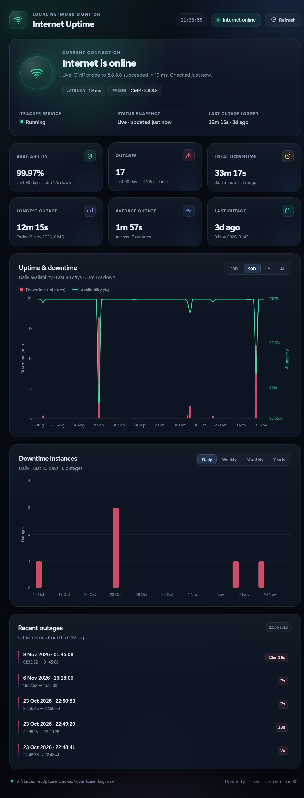

# Internet Uptime Dashboard

A local web dashboard for internet connectivity, backed by two small Windows
services:

| Service | What it does |
| --- | --- |
| `InternetUptimeTracker` | Pings `8.8.8.8` and records each completed outage to a CSV log. |
| `InternetUptimeTrackerDashboard` | Serves the dashboard and its JSON API on <http://127.0.0.1:8787>. |



The dashboard shows the live connection state, uptime/downtime charts, and
selectable daily/weekly/monthly/yearly outage counts. It binds to `127.0.0.1`
only, so nothing is exposed to the network.

## Install

Requires 64-bit Windows. Double-click
`artifacts\InternetUptimeTrackerSetup-2.0.0.msi` and approve the UAC prompt. The
installer:

- installs both services under `C:\Program Files\Internet Uptime Tracker\`,
- sets both services to start automatically and starts them immediately,
- adds an **Internet Uptime Dashboard** shortcut to your Desktop and Start Menu
  that opens <http://127.0.0.1:8787/>,
- removes any legacy hand-installed `InternetUptimeTracker` service first,
- leaves existing history untouched: on first start the tracker copies
  `D:\InternetUptimeTracker\*` into `C:\ProgramData\InternetUptimeTracker\`.

Uninstall from **Settings → Apps → Installed apps**. The log in
`C:\ProgramData\InternetUptimeTracker` is intentionally kept.

## Build

Requirements: the .NET 10 SDK (the repo pins `10.0.404` in `global.json` with
roll-forward) and PowerShell 7 for the installer script. All projects target
`net10.0`.

```powershell
dotnet build InternetUptimeTracker.slnx -c Release
```

Build the self-contained installer (no .NET runtime needed on the target PC):

```powershell
pwsh -NoProfile -ExecutionPolicy Bypass -File .\installer\build.ps1 -Configuration Release -Version 2.0.0
```

This publishes both apps to `artifacts\publish\{tracker,dashboard}` and writes
`artifacts\InternetUptimeTrackerSetup-2.0.0.msi` using WiX 7.

WiX 7 requires accepting the Open Source Maintenance Fee EULA at build time;
this is set in `installer\InternetUptimeTracker.Installer.wixproj` via
`<AcceptEula>wix7</AcceptEula>`. See <https://wixtoolset.org/osmf/> — fee terms
apply to qualifying organizations.

## Run from source

```powershell
# dashboard (reads the legacy folder until the new one exists)
dotnet run --project .\src\InternetUptimeTracker.Dashboard

# tracker (writes to .data\ in Development)
dotnet run --project .\src\InternetUptimeTracker
```

Then open <http://127.0.0.1:8787>. Development settings live in each project's
`appsettings.Development.json` and point at a local `.data` folder.

## Data

Both services share one folder, `C:\ProgramData\InternetUptimeTracker`:

- `downtime_log.csv` — one row per completed outage. `DateTime` is the local
  time connectivity returned; `DelayInSeconds` is how long the outage lasted.
- `connection_status.json` — `Offline`, `LastCheckedUtc`, and
  `OutageStartedUtc` (only while offline). The file is refreshed every couple
  of seconds so the dashboard can show a live outage timer, and an outage can
  survive a service restart.

The dashboard falls back to `D:\InternetUptimeTracker` when the new files do
not exist yet, so history is visible immediately after an upgrade.

## Configuration

Installed services read `appsettings.json` next to each executable. Files are
installed with `NeverOverwrite`, so local edits survive upgrades.

`Tracker` section (tracker):

| Setting | Default | Meaning |
| --- | --- | --- |
| `PingHost` | `8.8.8.8` | Host to ping. |
| `PingTimeoutMs` | `2000` | ICMP timeout. |
| `CheckIntervalMs` | `1000` | Time between probes. |
| `MinimumOutageMs` | `2000` | Shorter blips are ignored and not logged. |
| `StatusHeartbeatMs` | `2000` | How often the status file is rewritten. |
| `DataDirectory` | `C:\ProgramData\InternetUptimeTracker` | Where the CSV/status files live. |
| `LegacyDataDirectory` | `D:\InternetUptimeTracker` | Old location to import from. |
| `MigrateLegacyData` | `true` | Copy legacy files on first start. |

`Data`/`Dashboard` sections (dashboard app):

| Setting | Default | Meaning |
| --- | --- | --- |
| `Dashboard:Url` | `http://127.0.0.1:8787` | Listening address. |
| `Data:DataDirectory` | `C:\ProgramData\InternetUptimeTracker` | Where to read the CSV/status files. |
| `Data:LegacyDataDirectory` | `D:\InternetUptimeTracker` | Fallback location. |
| `Data:PingHost` / `PingTimeoutMs` | `8.8.8.8` / `1500` | Live probe for the status card. |
| `Data:TrackerProcessName` | `InternetUptimeTracker.exe` | Process checked for the "tracker running" indicator. |

Any setting can be overridden with an `IUT_` environment variable using `__`
for nesting, for example `IUT_Tracker__PingHost=1.1.1.1` or
`IUT_Dashboard__Url=http://127.0.0.1:8790`.

Both services run as `LocalSystem`, which is why they can write to
`C:\ProgramData`.

## API

| Route | Purpose |
| --- | --- |
| `GET /api/health` | Liveness check. |
| `GET /api/status` | Live ping, tracker status file, and process check. |
| `GET /api/data?range=90&scale=day` | Dashboard payload. `range` is `30`, `90`, `180`, `365`, or `all`; `scale` is `day`, `week`, `month`, or `year`. |

## Managing the services

```powershell
Get-Service InternetUptimeTracker, InternetUptimeTrackerDashboard
Restart-Service InternetUptimeTracker
Get-Content C:\ProgramData\InternetUptimeTracker\downtime_log.csv -Tail 5
```

Service start/stop messages go to **Event Viewer → Windows Logs → Application**
with sources `InternetUptimeTracker` and `InternetUptimeTrackerDashboard`.

## Layout

```
src\InternetUptimeTracker\              tracker worker (ping, CSV, status)
src\InternetUptimeTracker.Dashboard\    ASP.NET Core app + wwwroot UI
installer\                              WiX MSI definition and build script
artifacts\                              publish output and MSI (git-ignored)
docs\screenshot.png                     dashboard screenshot
```

The dashboard UI in `src\InternetUptimeTracker.Dashboard\wwwroot` is served
as-is; no build step or npm install is required.
